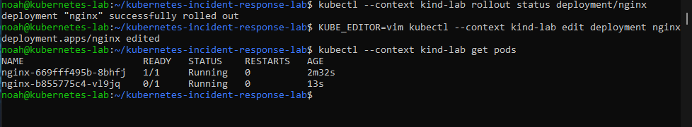

# Kubernetes Incident Response Lab

I ran the same NGINX image three ways: with Docker, with Compose, and in a local Kubernetes cluster. Then I broke one line of configuration and found out why Kubernetes kept two copies running when I’d asked for one.

| Checkpoint | What I saw |
| --- | --- |
| [Docker](docs/docker-baseline.md) | Published port 8080, got HTTP 200, and found the GET and HEAD requests in the logs. |
| [Compose](docs/compose-baseline.md) | Stopped the manual container and brought the same URL back with my [Compose file](compose.yaml). |
| [Kubernetes](docs/kubernetes-baseline.md) | Started a cluster with kind, deployed NGINX, and got HTTP 200 through its Service from a test Pod. |
| [Readiness incident](docs/readiness-incident.md) | Changed the check to a missing page. The new copy got a 404, the old one stayed ready, and restoring the path brought the Deployment back to one ready copy. |

Each walkthrough includes terminal screenshots and expandable command notes. I wrapped up after diagnosing and fixing the readiness incident.
