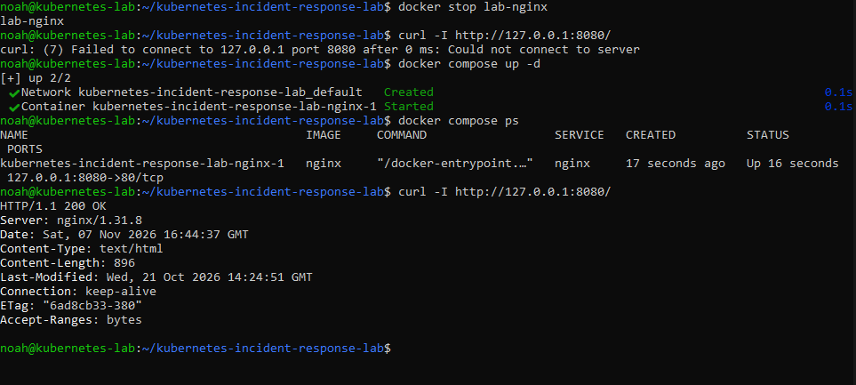

# Docker Compose baseline

I wrote [compose.yaml](../compose.yaml) in Vim to run the same NGINX image with the same port mapping as the [manual Docker baseline](docker-baseline.md).

```bash
docker compose config
docker stop lab-nginx
curl -I http://127.0.0.1:8080/
docker compose up -d
docker compose ps
curl -I http://127.0.0.1:8080/
```

<details>
<summary>Commands explained</summary>

- `docker compose config` validates and prints the resolved configuration. The YAML `ports` field replaces `docker run -p`. Compose showed host IP `127.0.0.1`, published port `8080`, and target port `80`.
- `docker stop lab-nginx` stops the original container and frees its published port.
- `docker compose up -d` starts the service defined in the file. `-d` leaves it running in the background.
- `docker compose ps` shows the running containers and port mappings for this project.
- `curl -I` sends a HEAD request and displays the status and response headers.

</details>

The request failed after I stopped the original container. Compose then created its default network and started the NGINX service with the same port mapping. The request to the same URL returned `200 OK`.


