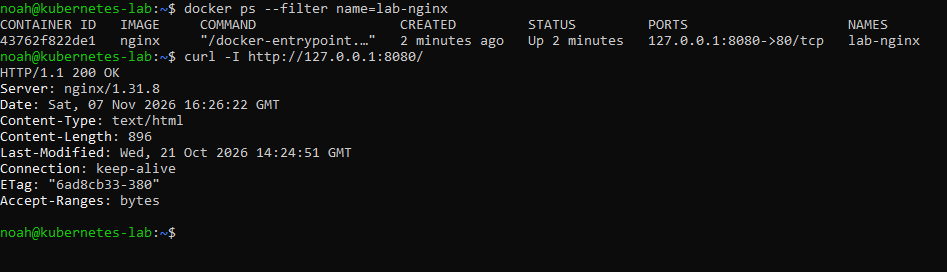

# Docker baseline

I ran NGINX on my Linux laptop from an SSH session on Windows. The goal was to start a container and verify that it served HTTP traffic through a published port.

```bash
docker run -d --name lab-nginx -p 127.0.0.1:8080:80 nginx
docker ps --filter name=lab-nginx
curl -I http://127.0.0.1:8080/
```

<details>
<summary>Commands explained</summary>

- `docker run` creates and starts a container from the `nginx` image. `-d` runs it in the background, and `--name lab-nginx` gives it a name for later commands.
- `-p 127.0.0.1:8080:80` publishes port 8080 on the Linux laptop's loopback address and forwards traffic to port 80 inside the container.
- `docker ps` lists running containers. `--filter name=lab-nginx` narrows the list by container name.
- `curl -I` sends an HTTP HEAD request and displays the status and response headers. Lowercase `-i` includes headers in the output without changing the request method.

</details>


Docker pulled the NGINX image on the first run and started a container named `lab-nginx`. The container listing showed it running with the mapping `127.0.0.1:8080->80/tcp`. The HTTP request returned `200 OK` from NGINX.



The Linux laptop receives the request on port 8080. Docker forwards it to port 80 inside the container, where NGINX handles it. Because I ran curl inside SSH, `127.0.0.1` referred to the Linux laptop.

## Check the access log

Send a GET request, then look for `"GET / HTTP/1.1"` and status `200` on the same log line.

```bash
curl -s -o /dev/null http://127.0.0.1:8080/
docker logs --tail 5 lab-nginx
```

<details>
<summary>Commands explained</summary>

- `curl` sends GET by default for this URL. `-s` hides progress and curl error messages. `-o /dev/null` discards the response body.
- `docker logs` reads the logs for `lab-nginx`. `--tail 5` limits the output to the last five lines.
- If curl prints nothing and no new request appears in the log, use `-sS` in place of `-s` to show errors while keeping the progress meter quiet. Check that the URL starts with `http://`.

</details>

The final two access log entries showed the earlier HEAD request and the new GET request:

```text
[07/Nov/2026:16:26:22 +0000] "HEAD / HTTP/1.1" 200 0
[07/Nov/2026:16:34:58 +0000] "GET / HTTP/1.1" 200 896
```

Both returned status 200. NGINX logged zero response body bytes for HEAD and 896 for GET. The GET body was sent by NGINX and discarded locally by curl.
