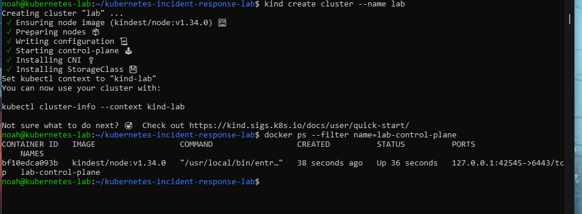
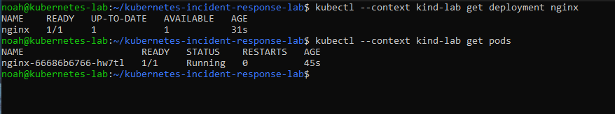
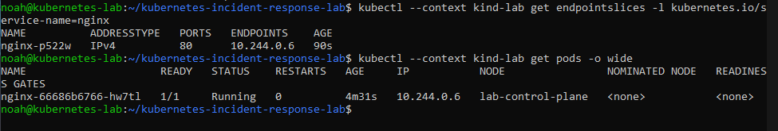
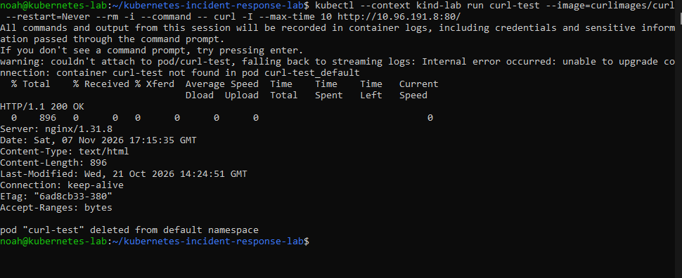

# Kubernetes baseline

## Create the local cluster

I used kind v0.30.0 to create a single-node cluster on the same Linux laptop where I ran the Docker Compose baseline.

```bash
kind version
kind create cluster --name lab
docker ps --filter name=lab-control-plane
```

<details>
<summary>Commands explained</summary>

- `kind version` reports the installed kind version.
- `kind create cluster` starts and configures Kubernetes in Docker. `--name lab` names the cluster and gives its kubectl context the name `kind-lab`.
- `docker ps` lists running Docker containers. `--filter name=lab-control-plane` shows the container that acts as the cluster's node.

</details>

Docker showed `lab-control-plane` running from `kindest/node:v1.34.0`.



## Run NGINX

```bash
kubectl --context kind-lab create deployment nginx --image=nginx
kubectl --context kind-lab get deployment nginx
kubectl --context kind-lab get pods
```

<details>
<summary>Commands explained</summary>

- `--context kind-lab` selects the lab cluster for each command.
- `create deployment nginx` asks Kubernetes to keep one copy running by default. `--image=nginx` selects the same image reference used in Compose.
- `get deployment nginx` shows how many copies are ready out of the requested total.
- `get pods` lists the Pods. On the NGINX Pod's row, `READY 1/1` means its one container is ready.

</details>

The Deployment showed one ready copy. The Pod was running with one ready container and zero restarts.



## Check which Pod the Service found

```bash
kubectl --context kind-lab expose deployment nginx --port=80 --target-port=80
kubectl --context kind-lab get endpointslices -l kubernetes.io/service-name=nginx
kubectl --context kind-lab get pods -o wide
kubectl --context kind-lab get service nginx
```

<details>
<summary>Commands explained</summary>

- `expose deployment nginx` creates a Service for the Deployment's Pods. `--port=80` sets the Service port, and `--target-port=80` points it to port 80 on the Pod.
- `get endpointslices` shows the backend addresses. `-l kubernetes.io/service-name=nginx` filters for slices belonging to this Service.
- `get pods -o wide` adds details including the Pod IP and node.
- `get service nginx` shows the Service's internal IP and the port clients use.

</details>

The EndpointSlice listed `10.244.0.6` on port `80`. The running NGINX Pod also had IP `10.244.0.6` and showed `READY 1/1`. This confirmed that Kubernetes had identified the Pod as a backend for the Service. An HTTP request through the Service will test whether traffic reaches it.



The Service listed `10.96.191.8` under `CLUSTER-IP` and `80/TCP` under `PORT(S)`. Clients inside the cluster can use `10.96.191.8:80` to reach the Service, which currently has `10.244.0.6:80` as its NGINX backend.

## Send a request through the Service

```bash
kubectl --context kind-lab run curl-test --image=curlimages/curl --restart=Never --rm -i --command -- curl -I --max-time 10 http://10.96.191.8:80/
```

<details>
<summary>Commands explained</summary>

- `run curl-test` creates a Pod named `curl-test`. `--image=curlimages/curl` selects an image with curl installed.
- `--restart=Never` makes the container a one-time task. `-i` attaches the terminal with stdin open, and `--rm` removes the Pod after the attached run.
- `--command` uses the supplied command in place of the image's default command. `--` separates kubectl's flags from the command and arguments that run inside the Pod.
- `curl -I` sends HEAD to the Service IP. `--max-time 10` limits curl to 10 seconds once it runs.

</details>

Kubectl could not attach and streamed the container logs instead. The logs showed `HTTP/1.1 200 OK` and `Server: nginx/1.31.8`, confirming that NGINX answered a request sent from inside the cluster through the Service IP. Kubectl then deleted the test Pod.



## Add a working readiness probe

I edited the Deployment in Vim and added an HTTP readiness probe under the NGINX container settings:

```yaml
readinessProbe:
  httpGet:
    path: /
    port: 80
```

```bash
KUBE_EDITOR=vim kubectl --context kind-lab edit deployment nginx
kubectl --context kind-lab rollout status deployment/nginx
```

<details>
<summary>Commands explained</summary>

- `KUBE_EDITOR=vim` selects Vim for this edit. `edit deployment nginx` opens the live Deployment. Saving a change to its Pod template triggers a rollout.
- `rollout status deployment/nginx` watches the Deployment update until it completes.
- The probe sends an HTTP GET to `/` on the Pod's port 80 to check whether it is ready for traffic.

</details>

Kubectl reported `deployment "nginx" successfully rolled out`. This established a working probe before the failure exercise.
