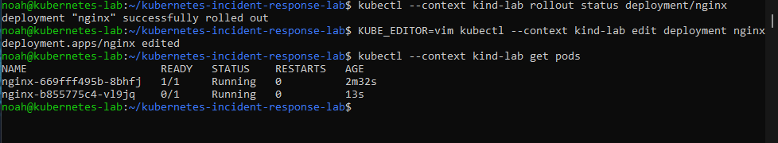
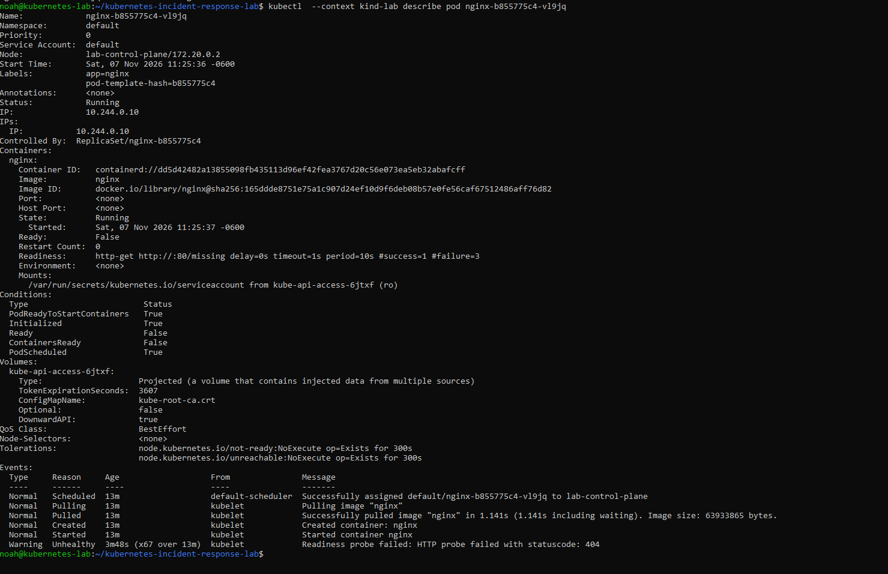

# Incident 1: NGINX rollout stalls

After verifying the working readiness probe at `/`, I edited the NGINX Deployment in Vim and changed only the probe path to `/missing`. I checked both Pods after saving:

```bash
kubectl --context kind-lab get pods
```

<details>
<summary>Commands explained</summary>

- `--context kind-lab` selects the lab cluster.
- `get pods` lists Pod states. `READY` counts ready containers, while `STATUS` reports the Pod's current state.

</details>

```text
NAME                     READY   STATUS    RESTARTS
nginx-669fff495b-8bhfj   1/1     Running   0
nginx-b855775c4-vl9jq    0/1     Running   0
```

The previous Pod remained ready while the replacement was running but unready.



## Diagnose the failed check

```bash
kubectl --context kind-lab describe pod nginx-b855775c4-vl9jq
```

<details>
<summary>Commands explained</summary>

- `describe pod` shows the named Pod's configuration, container state, and recent events. The Pod name came from `get pods`.

</details>

The container was running with zero restarts, but its readiness check requested `/missing` on port 80. The Events section reported:

```text
Readiness probe failed: HTTP probe failed with statuscode: 404
```

The check requested a page NGINX did not have. That explains why the replacement Pod was running and still marked unready.

## Restore the working check

I changed the probe path back to `/` in the Deployment and verified the result:

```bash
kubectl --context kind-lab rollout status deployment/nginx --timeout=60s
kubectl --context kind-lab get pods
```

<details>
<summary>Commands explained</summary>

- `rollout status deployment/nginx` checks whether the Deployment update has finished. `--timeout=60s` limits how long kubectl waits.
- `get pods` confirms the number of Pods and their readiness after the update.

</details>

```text
deployment "nginx" successfully rolled out
NAME                     READY   STATUS    RESTARTS
nginx-669fff495b-8bhfj   1/1     Running   0
```

The original healthy Pod was still running. The unready replacement was gone, and the Deployment was back to one ready copy.


